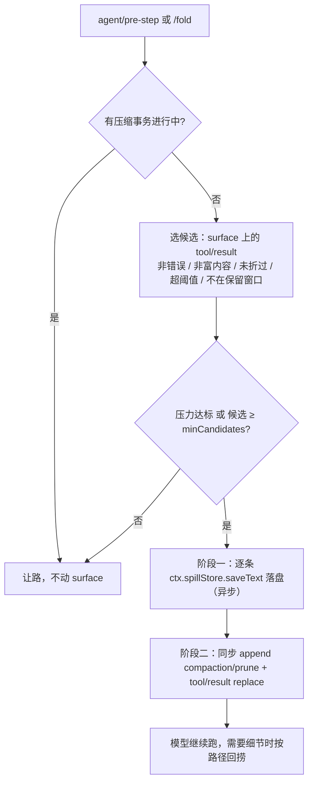

# dsh-session-fold — 会话折叠压缩

把长会话里**较早的超长工具输出**折叠成「保留头尾 + 元信息 + 原文路径」的短替身，
原文通过宿主 `ctx.spillStore` 落盘（session 作用域），需要细节时模型直接 `read` / `grep`
那个文件。**零 LLM 调用**，只在 step 边界动手。

English: this plugin deterministically folds older oversized tool results into
spill files and keeps a short head/tail stub with the recovery path. No extra
model call; it complements `dsh-compaction-basic` instead of replacing it.

仓库：<https://github.com/kennethfan/dsh-session-fold>

## 为什么需要它

| 现有机制 | 何时生效 | 留白 |
|---|---|---|
| `dsh-spill-policy` | 单条结果 > 12500 估算 token，工具返回时 | 1–12k token 的中等输出全部原样留在历史里 |
| `dsh-compaction-tool-result-pruner` | 压缩被触发时，裁 8k 字符以上的结果 | 压力没到阈值就永远不跑 |
| `dsh-compaction-basic` | 上下文约 80% 窗口 | 要花一次模型调用写摘要，且摘要会丢命令细节 |

会话里「命令 + 输出」成串累积时，上面的机制都慢一步。本插件补的是这段空档：
在**每次 step 开始前**，按压力或候选数量触发一次确定性折叠，一路把老输出替换成
一条可回捞的短文本，让上下文提前瘦下来，`compaction-basic` 的 LLM 摘要因此很少被触发。

## 折叠后模型看到什么

```
<原文开头 200 字符>

…[输出已折叠] #3 bash command=go test ./...
原输出 812 行 / 61234 字符 / 58.7 KB
完整原文：/Users/kenneth/.dsh/.../spill/bash-2-....txt
回捞：read 或 grep 这个文件：/Users/kenneth/.dsh/.../spill/bash-2-....txt…

<原文结尾 80 字符>
```

## 机制



关键不变量（都是宿主契约，不能违背）：

1. **日志是唯一真相**：折叠必须落成真正的 surface 替换事件
   `session.append('tool/result', …, { surfaceOp: { op: 'replace', startSeq, endSeq } })`，
   而不是只改内存消息；`sourceEventSeqs` 完整覆盖被遮蔽节点，回放/分叉可确定性重建。
2. **影子计价必须紧邻**：`compaction/prune` 事件必须在它的 replace 事件**之前同步**追加，
   中间不能有 `await`。所以「先异步落盘、再同步替换」分两阶段。没挂压缩体系时该事件
   未注册，插件会省略它并在日志里 debug 一次，替换本身仍然合法。
3. **不抢写**：日志里存在未闭合的 `compaction/start` 时整轮跳过，避免和 compaction 抢 surface。

## 配置

全部有默认值，**两种改法写到同一处**：

1. **图形配置页**（推荐）：设置侧栏的「会话折叠压缩」，或插件页本包那一行点进去。
   12 个字段分「常用参数」（7）与「高级参数」（5，默认收起）两组。
   改的是**本地草稿**：编辑只标「未保存」，点 **保存** 才一次性写入 profile 的 Cordis patch，
   保存成功后才影响运行中的插件；另有 **放弃修改** 与 **恢复全部默认值**。草稿在保存前会先本地
   校验（类型、范围、`foldThresholdChars > headChars + tailChars + 160`），不合格时保存按钮直接禁用。
2. **配置文件**：在 profile 的 `cordis.patch.yml` 用 `- id: session-fold` 覆盖（config 是整条替换，
   需要写全要保留的字段）。

注意：宿主写回时会把**当时表单里的全部取值**写进 patch（volatile 表单整体投影），所以保存过一次之后
这 13 个字段都被显式钉住，插件将来改默认值不会自动影响该 profile；想跟随新默认值就点「恢复全部默认值」。
页面上的「已自定义」只在取值真的偏离默认值时才显示。

配置页的写入经宿主 settings 表单落回 profile 的 Cordis patch，带 revision 防并发覆盖；
被 home patch 或命令行覆盖压住时会明确拒绝并提示。在会话里用 `/fold-config` 可随时查看当前生效值。

配置页提供 12 个字段（常用 7 + 高级 5）。**`pruneRoot` 故意不在页面上**：把 `/spill-prune`
指向错误目录有风险，只能在 profile 的 `cordis.patch.yml` 里手动设置，Host 侧仍有路径护栏。

| 字段 | 默认 | 含义 |
|---|---|---|
| `auto` | `true` | 是否在 step 边界自动折叠 |
| `foldAtRatio` | `0.25` | 上下文估算达到模型窗口的该比例时折叠 |
| `foldAtTokens` | `32768` | 解析不出模型窗口时使用的绝对阈值（估算 token） |
| `foldThresholdChars` | `800` | 单条结果纯文本超过该字符数才折 |
| `headChars` | `200` | 保留原文开头的字符数 |
| `tailChars` | `80` | 保留原文结尾的字符数 |
| `retainTurns` | `3` | **自动**折叠时最近 N 轮不折（第 7 轮时保护 turn 5/6/7）；手动 `/fold` 不受它约束 |
| `minCandidates` | `5` | 未达压力时累计多少条候选才触发 |
| `maxPerPass` | `20` | 单次折叠上限 |
| `command` | `true` | 是否注册 `/fold`、`/folds`、`/unfold` |
| `recallTool` | `true` | 是否给模型注册 `session_fold_recall` 工具 |
| `prune` | `true` | 是否注册 `/spill-prune` 命令 |
| `pruneRoot` | `''` | spill 根；留空则用后端 `ctx.spillStore.root` |

自相矛盾配置直接拒绝：`foldThresholdChars` 必须大于
`headChars + tailChars + 160`（否则折叠不会变小）。表单写入被拒时页面上会显示原因；
若某个中间值让配置暂时不自洽，Host 沿用上一次可用值并只记一条告警。

`command` / `recallTool` / `prune` 三个开关是**运行期生效**的：命令和工具仍然注册，
关闭时调用会得到「已在插件配置里关闭」的提示，而不是从菜单里消失。

## 使用

| 入口 | 作用 |
|---|---|
| 自动 | 长会话里什么都不用做 |
| `/fold` | 立即折一轮，跳过压力与候选数量门槛。保留策略按会话状态决定：轮次进行中只保护**当前这一轮**，已经空闲则全折（否则短会话里手动命令永远无事可做）。返回折了多少条、约省多少 token、落盘多少字节 |
| `/folds` | 列出当前会话表面上的所有折叠项：`#序号 · 工具与命令 · 原大小 · 原文路径` |
| `/unfold <序号>` | 把该条替身换回原文（日志 append-only，仍然可回放） |
| `/unfold all` | 恢复当前表面上全部折叠项 |
| `/fold-config` | 只读打印当前生效配置，并标注与默认值不同的项 |
| `/spill-prune` | 手动清理 spill 目录，见下面的「手动清理」一节 |
| `session_fold_recall` 工具 | 模型按 `seq` 取回整条原文，或按 `pattern` 在所有折叠原文里逐行搜索；不传参则列清单 |

替身里带稳定 `#序号`（等于**原始事件 seq**）：

```
…[输出已折叠] #3 bash command=go test ./...
原输出 812 行 / 61234 字符 / 58.7 KB
完整原文：/Users/kenneth/.dsh/spill/session-xxxx/...-bash-3.txt
…
```

## 恢复

三层语义，别混：

1. **内容恢复** —— 永远可行。`/unfold` 与 `session_fold_recall` 直接从**会话日志**里的原始事件取原文
   （折叠只是新增遮蔽事件，原事件没被删），所以**即使 spill 文件被清理也能恢复**；spill 路径只是方便
   `read`/`grep` 的快捷方式。
2. **上下文恢复** —— `/unfold` 会把替身节点换回原文，下一轮模型请求就能重新看到那段内容。
   恢复本身也是一条 `surfaceOp: replace` 事件（同样带影子计价），会话依旧可回放、可分叉。
3. **整段历史回滚** —— 不支持。日志 append-only，没有「删掉折叠事件」的操作；要回到折叠前只能
   另开会话或从备份恢复。

## 安装

```sh
# 已发布版本（v0.1.0，资产名固定不带版本号，链接长期有效）
plugin_manager: action=install_bundle, target=https://github.com/kennethfan/dsh-session-fold/releases/latest/download/dsh-session-fold.tgz

# 本地目录（开发用）
plugin_manager: action=install_bundle, target=/path/to/dsh-session-fold
```

安装会往 profile 的 `dsh.profile.bundles` 追加 `dsh-session-fold`，其
`cordis.patch.yml` 自动插入 `session-fold` 一行。

**改完代码不用重启 DSH**：profile 的 HMR 在 recomposition 时会替换「文件在磁盘上已改动」
的已安装/链接包，最省事的做法是对该 entry 关开一次（`plugin_manager` `set_plugin`
`include:session-fold` 先 false 再 true）。判断新代码是否真的载入，看
`cordis_inspect_query(host, Tool.listTools)` 里有没有 `session_fold_recall`——
entry 的 `fiberPhase: active` 只说明旧代码还活着。

## 测试

```sh
cd dsh-session-fold && node --test
```

五套测试，共 52 个用例（`fold` 17、`prune` 9、`live-session` 3、`config` 11、`client-logic` 12）：

1. `test/fold.test.mjs` —— 最小 fake Session 复现宿主的 surface 语义（replace 移除区间、
   新节点入尾、日志事件不带 surfaceOp），覆盖保留窗口、错误结果、富内容、幂等、
   prune 紧邻、压缩进行中让路、手动保留策略、落盘与 token 记账、折叠与恢复往返。
2. `test/live-session.test.mjs` —— import 宿主随附的 `@deepseek-ai/dsh-session`，
   在真实 `Session.append` 校验下跑折叠与恢复，确认 replace 事件、`sourceEventSeqs` 覆盖、
   `compaction/prune` 影子计价都被真实契约接受。模块位置**动态解析**，按顺序尝试：
   `DSH_SESSION_MODULE` 环境变量 → 本地 `node_modules` → `~/.nvm/versions/node/*/lib`、
   `/usr/local/lib`、`/opt/homebrew/lib`、`~/.local/lib` 下的全局 DSH 安装；
   全都找不到才跳过（并打印跳过理由）。
3. `test/prune.test.mjs` —— `/spill-prune` 的参数解析、根校验、目录扫描、孤儿判定、
   按龄判定与删除护栏，全部在 `os.tmpdir` 的临时 fixture 里跑。
4. `test/config.test.mjs` —— 配置字段元数据、volatile 引用读写、`resolveConfig` 校验规则、
   `/fold-config` 的 `← 与默认值不同` 标注，以及「只有 pruneRoot 不进配置页」。
5. `test/client-logic.test.mjs` —— 配置页的纯逻辑：草稿转换、范围与跨字段预算校验、
   mutation ops 组装、命名空间解析。`client.js` 在 Node 下（无 `window`）把纯函数挂到
   `globalThis.__sessionFoldClientInternals`，因此这些只在浏览器里才会暴露的坑（比如数字字段
   拿字符串提交、被宿主按 schema 拒绝）可以在 `node --test` 里回归。

## 手动清理 spill

`/spill-prune` 默认只预览，`--apply` 才真删：

| 参数 | 含义 |
|---|---|
| 无 | 预览：列出「对不上任何现存会话」的目录 |
| `--apply` | 执行删除 |
| `--older-than N` | 额外把 mtime 超过 N 天的目录纳入（不论是否孤儿） |
| `--all` | 纳入全部目录（含存活会话的） |

判定依据：目录名 `session-<sha256(sessionId)[:12]>` 是否落在 `ctx.sessionQuery.listSessions()` 的 id 集合里。
**归档会话算存活**（归档只是 UI 分组，可 unarchive），因此归档会话的 spill 不会被清。

护栏（都在代码里）：只碰根的直接子目录且名字必须匹配 `^session-[0-9a-f]{12}$`；软链接跳过；根太浅或等于 `~`、`~/.dsh`、`~/.dsh/sessions` 时拒绝执行；会话索引取到 0 条时拒绝执行；当前会话的目录永不删。

## 已知边界

- 只折 `tool/result` 的**纯文本**内容；含图片/文件块的结果一律不折（交给官方 image-offload / pruner）。
- 不折 `isError: true` 的结果（错误线索通常短且关键）。
- 不折 user/assistant 消息；不会把「命令记录」本身合并成一行（保留工具调用结构）。
- 折叠会让 provider 的 prompt cache 从第一个被改动的消息起失效；触发是「压力达标才批量折一次」，
  而不是每步都折，就是这个原因。
- spill 文件的保留期限由 `dsh-spill-local` 决定（默认 30 天，只在 DSH 启动时扫一次）；
  推荐把落点固定到稳定目录并按需保留，例如 `root: ~/.dsh/spill`、`cleanupPeriodDays: 7`。
  即使被清理，`/unfold` 与 recall 工具走日志，不受影响；要立刻清可以手动跑 `/spill-prune`。
- 单条仍巨大且不可分的结果（例如一次 200k 字符的输出）折后依旧占位：本插件按头尾预算折叠，
  能压到约 400 字符 + 元信息。
